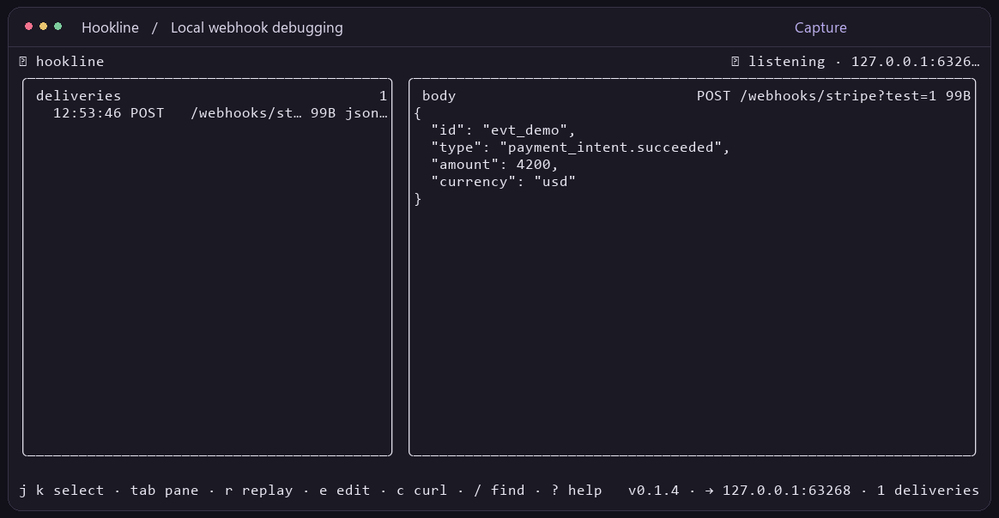

# ◆ hookline

A local-first webhook inspector that lives in your terminal. Run one
binary, point webhooks at it, and watch deliveries land in a fast,
keyboard-driven TUI — inspect pretty JSON, replay to your dev server, edit
payloads and resend, or copy a complete delivery as a cURL command. Nothing leaves
your machine unless you press replay.

## Why

Debugging webhooks means answering "what exactly did they send me?" while
providers retry and payloads scroll past in server logs. Web-based tools
(webhook.site, RequestBin) make you paste payloads into a browser; SaaS CLIs
want an account. hookline is none of that: offline, no signup, one static
binary, and it blends into whatever terminal you already customized.

## Features

- **Capture everything** — any method, path, header, content type; JSON,
  urlencoded forms, or binary (hex view). Bursts are queued,
  backpressure-aware: drops are counted and shown, never silently lost.
- **Inspect fast** — syntax-highlighted JSON, aligned headers, raw bytes,
  auto-response; unread markers for new arrivals; live search (`/`, matches
  headers too) and method filter (`f`).
- **Replay & edit** — resend a complete delivery to a target (`r`),
  round-trip the body through `$EDITOR` with a diff review, then send (`e`).
  The target's answer lands in the response tab; toasts are colored by
  status class. Each non-loopback replay shows the destination and request
  for confirmation with uppercase `Y`. The target persists to `config.json`
  between runs.
- **Signature re-signing** — signature re-signing for Stripe, GitHub and
  Shopify so replays verify: start with `--sign stripe` and
  `HOOKLINE_SIGN_SECRET` and every resend (edited bodies included) carries
  a fresh signature. A missing secret refuses to send — never unsigned.
- **Export** — copy a complete delivery as a POSIX-shell cURL command (`c`) or copy the
  available raw body (`y`). Replay and cURL export require a complete capture.
  Copies use OSC 52, so they work inside SSH sessions.
- **Persistent** — history survives restarts as JSONL on disk
  (`--fresh` rotates it aside to `hookline-<timestamp>.jsonl`, keeping 5,
  instead of deleting). The listener’s HTTP status acknowledges receipt.
  Check the TUI for save failures. A `!` beside a live delivery marks a
  failed save, and the status bar counts save failures separately from
  dropped live updates.
- **Blend in** — transparent backgrounds, auto dark/light detection,
  truecolor with graceful degradation to 256/16/mono, `NO_COLOR` respected,
  window title set on start. Your terminal's theme shows through, not ours.

## Install

Download the archive for your operating system and architecture from
[GitHub Releases](https://github.com/DJJW26/hookline/releases/latest).
Extract it and run `hookline --version` (`.\hookline.exe --version` in
PowerShell). The release includes a SHA-256 checksum file.

To install with Go 1.27.2 or newer:

    go install github.com/DJJW26/hookline/cmd/hookline@latest

Or build from a checkout:

    git clone https://github.com/DJJW26/hookline.git && cd hookline
    go build -o hookline ./cmd/hookline

## Quickstart

- [Capture and replay a sample locally](docs/RECIPES.md#local-quickstart) with shell and PowerShell commands.
- [Replay an edited Stripe event with signature verification](docs/RECIPES.md#stripe-cli-with-signature-verification).
- [Capture and replay GitHub webhooks through an existing tunnel](docs/RECIPES.md#github-webhook-over-a-tunnel).

## Keys

| Key | Action | Key | Action |
|---|---|---|---|
| `j k` / `↑ ↓` | select / scroll | `r` `R` | replay selected / latest |
| `PgUp/PgDn` | page (or ctrl+u/d) | `e` | edit body & resend |
| `n` | next unread | `c` / `y` | copy as cURL / copy body |
| `tab` | switch pane | `t` | set replay target |
| `enter` | inspect delivery | `f` | filter by method |
| `1-4` `h l` | detail tabs | `x` | clear history (confirm) |
| `/` | search (incl. headers) | `?` | help |
| `g` `G` | top / bottom | `q` | quit |

Mouse works too: click to select, wheel to scroll.

## Themes

`--theme auto` (default) follows your terminal's light/dark background.
Also available: `dark` (Dusk — purple accents on your terminal's own
canvas), `light` (Linen), `mono` (Graphite — zero color, weight-only
hierarchy). The palette lives in `internal/style/theme.go`; themes are
registry entries, so adding one is a single struct.

## Flags & data

    --port 4040        listen port            --status 200   reply status
    --bind 127.0.0.1   listen address         --target URL   default replay target
    --theme auto       dark|light|mono|auto   --fresh        rotate history aside
    --sign P           re-sign replays: stripe|github|shopify
    --version

History is JSONL in `%LOCALAPPDATA%\hookline` (Windows) or
`$XDG_DATA_HOME/hookline` (elsewhere); override with `HOOKLINE_DATA_DIR`.
The replay target lives in `config.json` next to it. With `--sign`, the
webhook secret comes from `HOOKLINE_SIGN_SECRET`. For Stripe, use the full
endpoint secret, including the `whsec_` prefix. Copies fall back to
`HOOKLINE_CLIP_CMD` (e.g. `clip.exe`, `wl-copy`) on terminals without
OSC 52.

## Status

See [the workplan](docs/WORKPLAN.md) for release work and pilot goals, and
[the architecture](docs/ARCHITECTURE.md) for how Hookline works.

Tagged builds are packaged with GoReleaser. The demo uses only localhost
and a test payload. To record the walkthrough with VHS, run
`vhs .vhs/demo.tape` from the repository root.

MIT licensed. Built with [Bubble Tea](https://github.com/charmbracelet/bubbletea)
and [Lip Gloss](https://github.com/charmbracelet/lipgloss).
